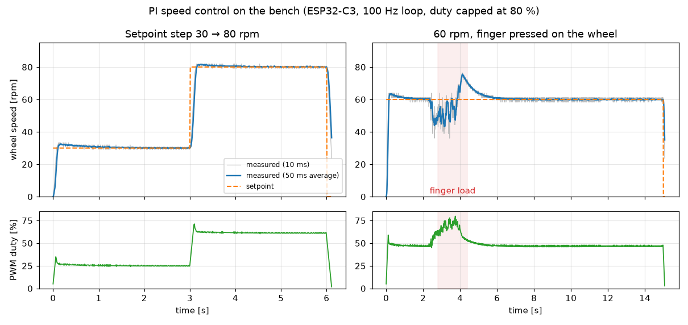
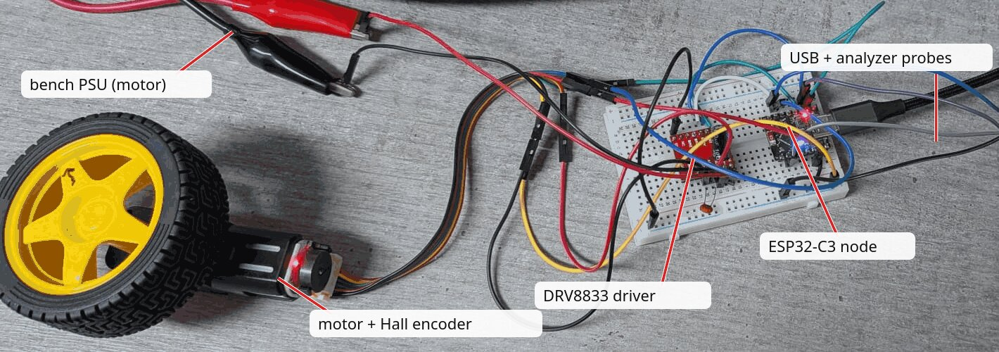
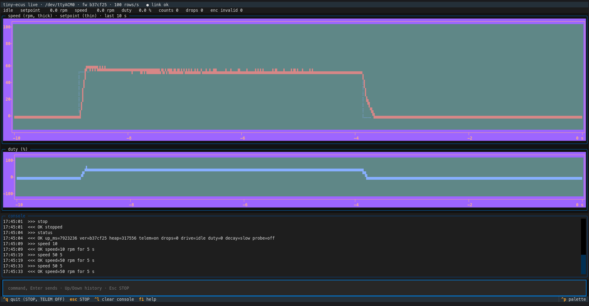
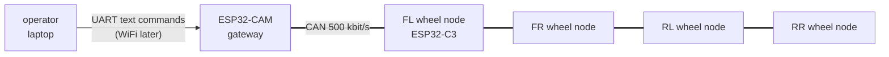

# tiny-ecus

[](https://github.com/shanirub/tiny-ecus/actions/workflows/build.yml)

[](LICENSE)

A 4WD skid-steer RC car built the way a real car's electronics are: each wheel has its own ESP32-C3 controller, and all of them talk over a CAN bus like the ECUs (electronic control units) in a vehicle. An ESP32-CAM is the gateway that takes remote commands. It's a learning-driven build of a real ECU architecture, and every phase ends in a measured acceptance test on real hardware.



*Recorded on the bench: one wheel node's speed controller following a setpoint step, then holding 60 rpm while a finger brakes the wheel. Drawn by [`tools/pi_figure.py`](tools/pi_figure.py) from the raw telemetry in [`docs/data/`](docs/data/).*



*The bench rig that recorded it: one wheel node with its motor and encoder, powered from a lab PSU, probed by a logic analyzer.*

## Goals

- Four independent wheel nodes that drive together smoothly, using closed-loop speed control with encoder feedback.
- Corner lights that stay in sync across nodes, through clock synchronization over CAN.
- Fail-safe behavior: the car stops on its own if a node or the remote link goes silent, and before the battery runs too low.
- Control traffic (CAN) kept separate from video traffic (WiFi).

## Status

| Phase | Delivers | Acceptance test | Status |
|---|---|---|---|
| 0. Foundations | Repo, toolchain, CI, hello-world on both boards | CI builds both projects from a clean clone | ✅ done |
| 1. One wheel node | Encoder decoding, motor drive with protections, PI speed control | The wheel holds a commanded speed under finger-drag load and reports it | ✅ done |
| 2. CAN bring-up + gateway | CAN on both chips, message code generated from a DBC file, gateway commands, fail-safe | A typed command spins the wheel; pulling the CAN wire stops it within 100 ms plus the ramp | 🔧 in progress |
| 3. Protocol + four nodes | Message catalogue, four wheels on one bus | Skid-steer drives all four; losing any node stops the car | planned |
| 4–7 | Synchronized lights, battery protection, WiFi control, video | | planned |

The detailed plans, every decision and the bench log: [`.planning/can-rc-car/`](.planning/can-rc-car/task_plan.md).

## Verification approach

The firmware is verified at three levels. Each level states what it can't cover, so the next one picks it up; [`test/README.md`](test/README.md) has the full matrix.

| Level | Proves | How |
|---|---|---|
| **Host unit tests** | The hardware-free logic (command parser, quadrature decoder, motor state machine, speed conversion, PI controller) does what its header promises, including limits and bad input | About 100 [Unity](https://github.com/ThrowTheSwitch/Unity) tests built with the PC's gcc, `-Wall -Wextra -Werror`, under AddressSanitizer and UndefinedBehaviorSanitizer |
| **Mutation tests** | The tests would actually catch realistic bugs | 53 hand-written mutants (a flipped sign, a missing clamp, a stall check that trips one step late…), planted one at a time by [`test/host/mutate.py`](test/host/mutate.py); each must make a test fail |
| **Bench checks** | Timing, wiring and the real motor: what no host test can see | Logic-analyzer captures, telemetry recorded with [`tools/plot_run.py`](tools/plot_run.py), and written pass criteria for each plan item, run before its PR is merged |

Everything except the bench runs in [CI](.github/workflows/build.yml) on every push and pull request, together with the firmware builds for both chips.

What this caught or settled:

- **A test that passed only by luck.** A mutant that replaces a wrapping unsigned add with a plain signed one survives on the PC, because the CPU happens to wrap to the value the test expects. Only UBSan catches it, which is why the sanitizers are part of the test run rather than an extra.
- **Expected values from the hardware, not the code.** The encoder's state sequence was recorded on the logic analyzer first. The exhaustive test of all 16 state transitions checks against that recording, so a mistake in the decoder's table can't be copied into its test.
- **A latent timing bug found in review.** The PI controller's software-float math ran inside an interrupt-masking critical section for up to 50 µs, longer than the shortest gap between encoder edges (14.4 µs). Moving it out brought the section down to 8.8 µs, measured on the chip with the CPU cycle counter.

### Bench tooling

The bench checks use small Python tools written for this project ([`tools/`](tools/README.md)): a recorder that captures the node's 100 Hz telemetry for a fixed time and plots it, a scripted command sender for repeatable runs, and a live terminal dashboard.



*`tools/live.py`: live speed and duty plots, link and drop counters, and a command console with a one-key STOP.*

## Engineering notes

Short write-ups of the measurements behind the main design decisions, each with its question, method, result and consequence:

- [**Encoder timing margin without a hardware counter**](docs/design/encoder-timing-margin.md). The ESP32-C3 has no pulse-counter peripheral, so every encoder edge is an interrupt. On the logic analyzer: 14.4 µs shortest edge gap against ≈ 9.8 µs worst-case handler time, a 1.5× margin, at ≥ 2.4 % CPU.
- [**Choosing the PWM decay mode**](docs/design/pwm-decay-mode.md). Fast decay does nothing below ≈ 45 % duty; slow decay is linear (≈ 1.37 rpm per % duty) down to 5 %, so slow decay was chosen.
- [**PI speed control: model vs bench**](docs/design/pi-speed-control.md). Gains picked on a plant model built from those measurements: 7 % overshoot predicted, 4–9 % measured.

## Architecture



Each wheel node drives one DC motor through a DRV8833 driver, reads a Hall quadrature encoder and holds its commanded speed in a 100 Hz control loop. Code that needs no chip lives in components with no ESP-IDF dependency, so it can be unit-tested on a PC; the code that touches pins, interrupts and FreeRTOS stays in the firmware projects. Full power, CAN and node diagrams: [`docs/architecture.md`](docs/architecture.md).

| Path | Contents |
|---|---|
| [`firmware/wheel_node/`](firmware/wheel_node/README.md) | the ESP32-C3 wheel node: encoder interrupt, motor drive, control loop, console, telemetry |
| [`firmware/gateway/`](firmware/gateway/) | the ESP32-CAM gateway |
| [`components/`](components/README.md) | shared and hardware-free code: command parser, quadrature decoder, motor logic, speed, PI controller |
| [`test/`](test/README.md) | host unit tests and the mutation-test harness |
| [`tools/`](tools/README.md) | Python bench tools: telemetry recorder and plotter, live terminal dashboard, command sender |
| [`docs/`](docs/) | architecture, parts list, design notes, wiring diagrams |

## Build and test

```sh
# host tests with sanitizers, then the mutation tests (gcc and CMake only)
cmake -S test/host -B build/host && cmake --build build/host
ctest --test-dir build/host --output-on-failure
python3 test/host/mutate.py

# firmware (ESP-IDF v6.1)
cd firmware/wheel_node && idf.py build
```

Installing the toolchain, flashing both boards and the bench tools: [`docs/dev-setup.md`](docs/dev-setup.md).

## Hardware

ESP32-C3 Super Mini (×4), ESP32-CAM, SN65HVD230 CAN transceivers, DRV8833 motor drivers, TT gear motors with Hall encoders, a 2S 18650 pack. Full list: [`docs/can-rc-car-parts-list-final.md`](docs/can-rc-car-parts-list-final.md). On the bench: a multimeter, a lab PSU, and an fx2lafw logic analyzer with sigrok / PulseView.

## More

- [Project overview](docs/can-rc-car-project-overview.md): goals, learning goals, principles and non-goals.
- [Roadmap and current status](.planning/can-rc-car/task_plan.md): the source of truth for project status.

## License

[MIT](LICENSE)
