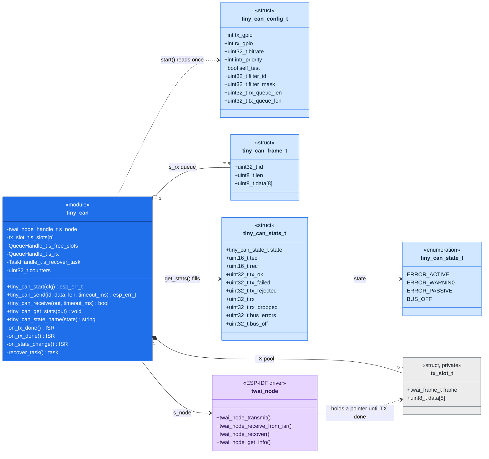
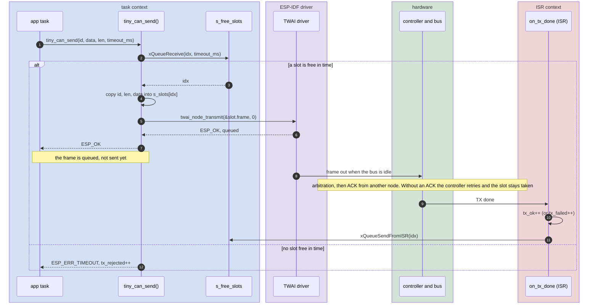
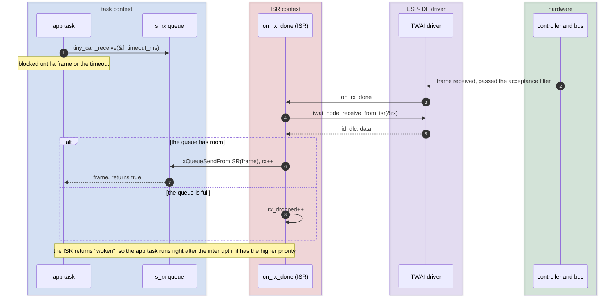
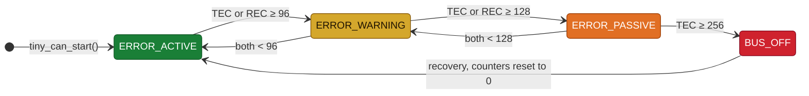
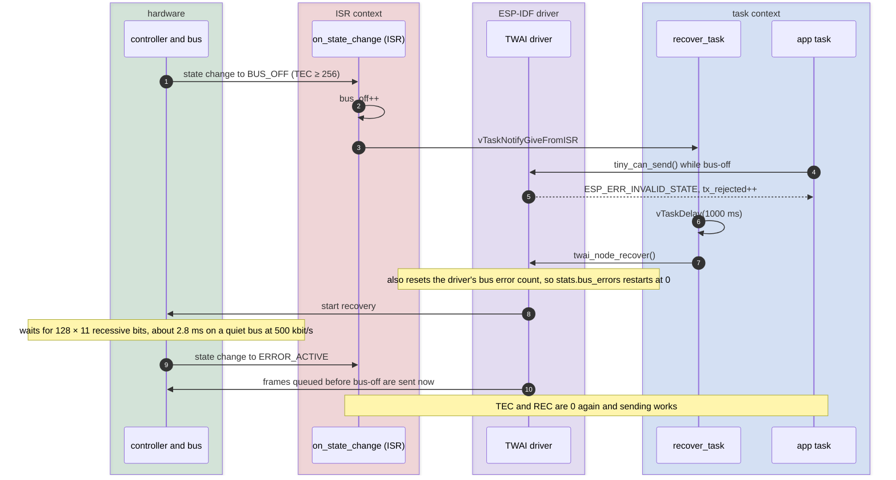

# tiny_can diagrams

Diagrams of how `tiny_can` works inside. The API itself is described in `include/tiny_can.h`.

Colours: in the sequence diagrams the background says where code runs (blue task context, red interrupt (ISR) context, purple ESP-IDF driver, green hardware); in the class diagram dark blue is the module, light blue its public types, grey a private one and purple the driver; the error states go from green to red.

## Structure

C has no classes, but a module that keeps file-scope `static` state and exposes functions behaves like a single object (a singleton). The class diagram below draws it that way:

- `tiny_can` is the module. Its `static` variables are private attributes (`-`), its public functions are `+` and its `static` functions are `-`.
- The structs (`<<struct>>`) and the enum (`<<enumeration>>`) are drawn as classes with data and no methods.
- A dashed arrow means "uses as a parameter" (a dependency). A filled diamond means "owns" (composition): the module allocates the TX slots and frees nothing, because they live as long as the program. An open diamond means "holds copies of" (aggregation).

`tx_slot_t` is private to `tiny_can.c`. It's drawn because it's the reason the module exists: the driver keeps a pointer to each queued frame, so the frame must live in memory the module owns until the driver reports it sent.

## Sending a frame

`tiny_can_send()` returns as soon as the driver has queued the frame. The frame goes on the bus later, and the TX-done interrupt hands its slot back.

## Receiving a frame

The driver gives out a received frame only inside its interrupt callback, so the callback copies it into a FreeRTOS queue and the task reads it from there.

## Error states and bus-off recovery

Every CAN node counts its own errors: the TEC (transmit error counter) goes up by 8 for each failed send, the REC (receive error counter) for each bad frame received, and both go down by 1 for each good frame. The counters decide the state:

A node that is the only one on the bus gets no ACKs and stops at a TEC of about 127, just short of passive: ACK errors alone don't push a node past passive. Bus-off needs real bus errors, such as a short or a wrong bitrate.

Bus-off is the one state the node doesn't leave by itself. `tiny_can` starts the recovery from a task, because the driver call isn't allowed in an interrupt:

