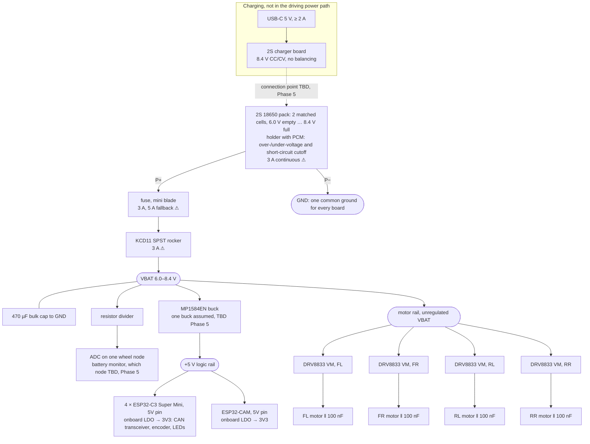
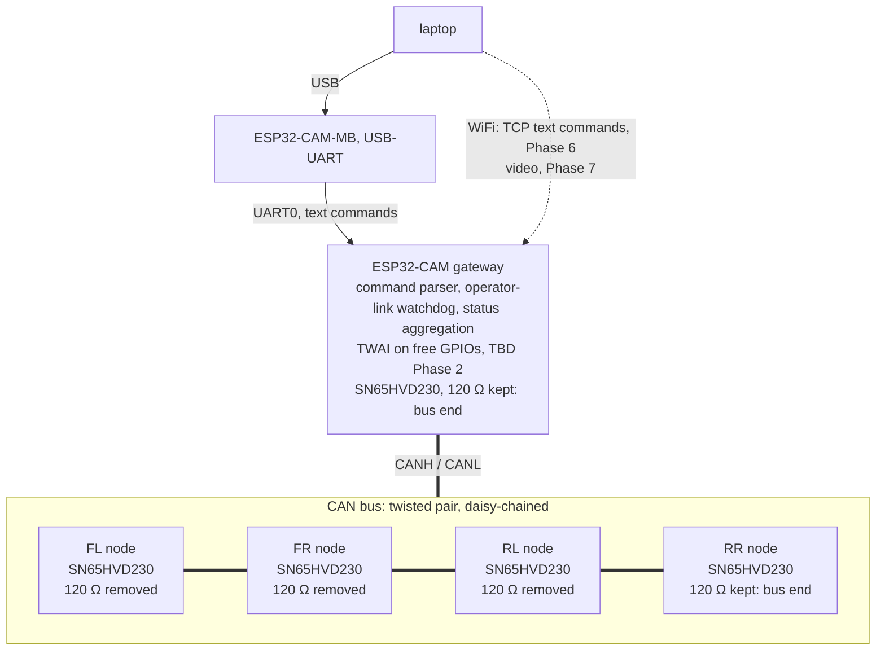
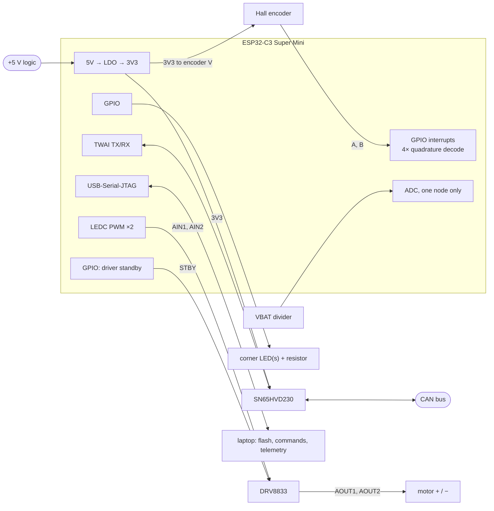

# CAN RC Car: System Diagrams

The target system as planned. Items marked *(TBD)* are decided in the phase named next to them. The roadmap is in `.planning/can-rc-car/task_plan.md`.

## 1. Power

⚠ Measured stall current is about 2.8 A per motor at 8.4 V, about 11 A for all four. That is above the PCM, fuse and switch ratings. Current limiting is planned for Phases 1 and 5 (see Risks in `task_plan.md`). Each DRV8833 bridge also cuts out on its own above 2 A minimum (3.3 A typical) and retries every 1.35 ms (TI datasheet).

## 2. Control and data

The order along the bus and the wiring layout are tentative: option D, gateway → left pod → right pod, confirmed in Phase 3 (see `docs/design/wiring-options.html`). Exactly two terminators are fitted, one at each physical end of the bus. With the bus unpowered, CANH–CANL measures about 60 Ω.

The frames on the bus (IDs, byte layout, rates) are defined in [`components/tiny_proto/README.md`](../components/tiny_proto/README.md).

## 3. One wheel node (×4, identical firmware, identity in NVS)

Encoder motor connector, from the silkscreen: `+ GND A B V -`, wire colors red, yellow, green, blue, red, black (same on all 5 motors). `+`/`-` are the motor winding, and `V`/`GND` power the Hall encoder. Two wires are red: the outer one is motor `+`, the inner one is encoder `V`. GPIO numbers are in `firmware/wheel_node/main/pins.h`. The node's firmware modules and the motor drive's states and sequences: `firmware/wheel_node/README.md`.
