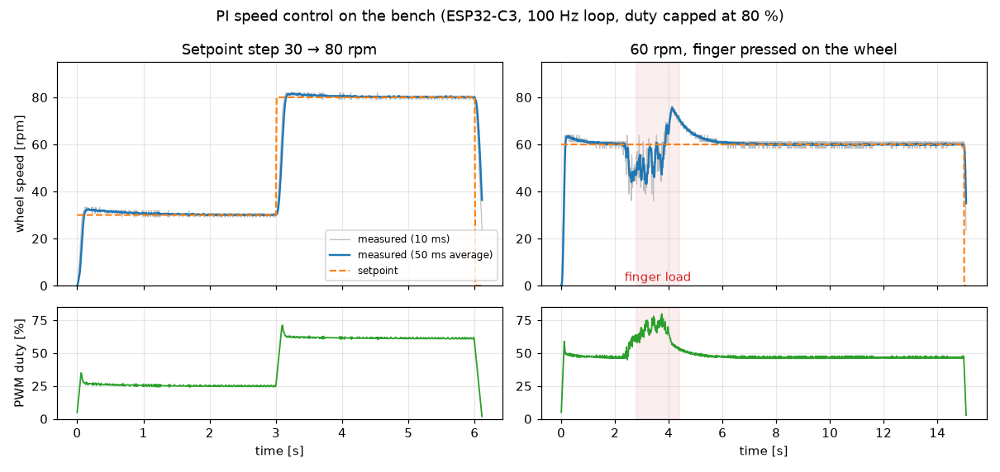

# PI speed control: model vs bench

Each wheel node holds a commanded speed with a PI controller (`components/tiny_pi`): feedforward from the measured duty-to-speed line, a proportional and an integral term, anti-windup (the integral freezes while the output is at the duty cap), all running in the 100 Hz drive loop. The gains were chosen on a plant model built from the earlier measurements, then checked on the bench.

The figure is drawn by `tools/pi_figure.py` from the two recorded runs in `docs/data/`.

## Question

Does the model used to pick the gains predict the real wheel well enough to keep those gains, and does the controller hold its speed under load?

## Result

- **Model vs reality:** about 7 % overshoot predicted, 9 % from rest and 4 % on a 30 → 80 rpm step measured. Close enough to keep the gains.
- **Under load** (Phase 1 exit test): a finger on the wheel costs ≈ 130 ‰ duty at 60 rpm, and the controller holds the speed. A firm press saturates the output at the cap; anti-windup freezes the integral, and after release the speed overshoots to ≈ 73 rpm for about 1.5 s.
- **Limit found:** a wheel that is slowed but still turning at the cap isn't caught by the stall check. On the car, the run timer and the Phase 2 setpoint watchdog bound it.

## Bench record

The full measurements, moved here from the project's findings log. Paths under `logs/` are local bench recordings that aren't in the repo; the two runs in the figure are in `docs/data/`.

### PI speed control on the bench (Phase 1 E, 2026-11-01, spare motor, wheel free, PSU 7.4 V)
- **Model vs reality:** the plant model used to pick the gains (rpm = 0.137 × duty ‰ − 4.2, 60 ms time constant, from D.4) predicted ≈ 7 % overshoot at kp 6 / ki 20; the bench gave 9 % from rest (65.3 rpm at 60) and 4 % on a 30 → 80 step. Close enough to keep the gains.
- **Steady state:** the duty needed for 60 rpm drifted 470 → 456 ‰ over 15 s (≈ 3 %), presumably the gearbox warming (as in D.4.2); the integral absorbs it. The feedforward predicts 469.
- **Load:** a light finger cost ≈ 130 ‰ duty at 60 rpm. A firm press needs more than the 800 ‰ cap can give; the controller then sits at the cap with the integral frozen (anti-windup), and after release overshoots to ≈ 73 rpm while the integral bleeds off (≈ 1.5 s at ki 20). Faster recovery would need a larger ki, which overshoots more on steps.
- **Stall during `SPEED`:** the trip fires 300 ms after the wheel stops, as with `DUTY`; the controller drives the duty to the cap first (≈ 80 ms). A slowed but turning wheel at the cap is not caught by the stall check; on the car only the run timer or (Phase 2) the setpoint watchdog limits it.
- **Bench method:** the camera can't take two photos 2 s apart (the second fails with "device busy" while the first ffmpeg still runs); space them ≥ 4 s.
