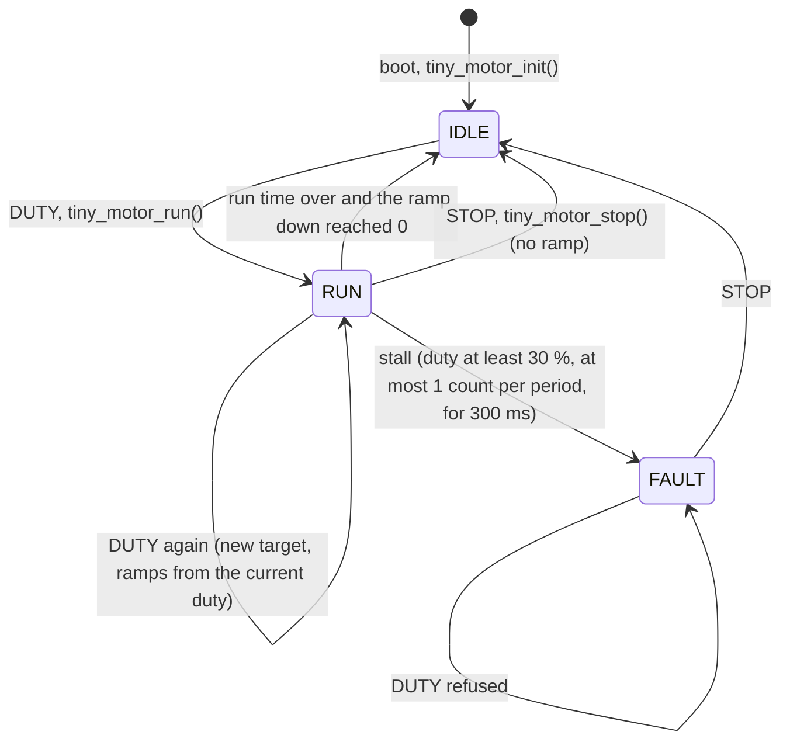
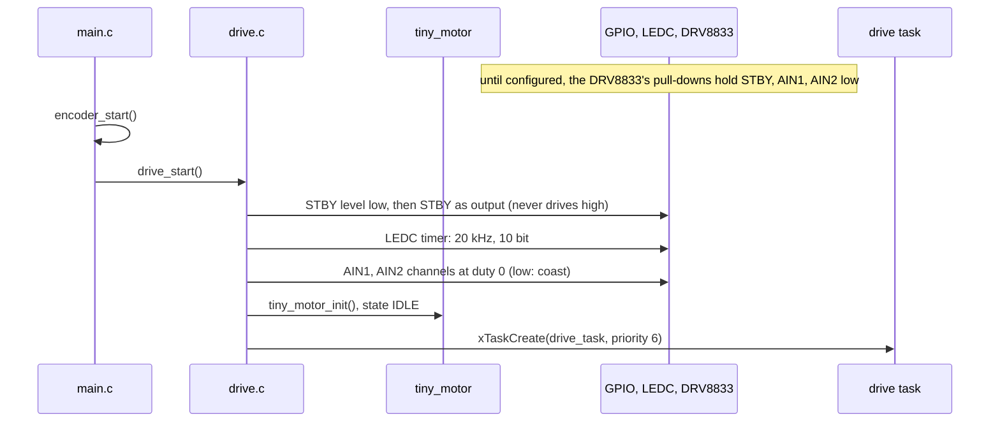
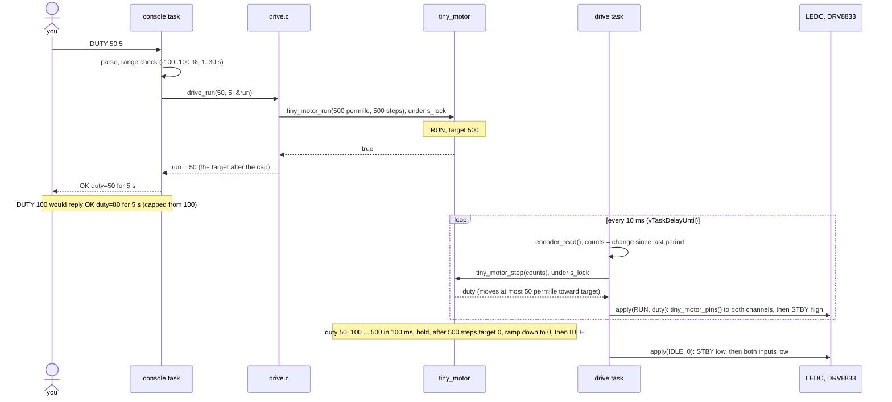
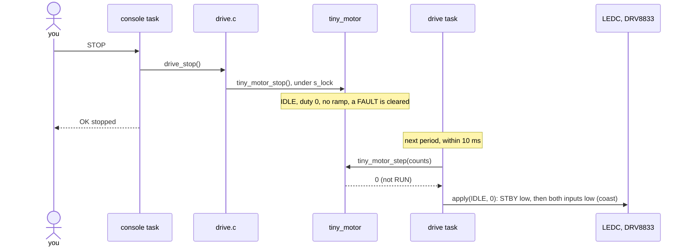
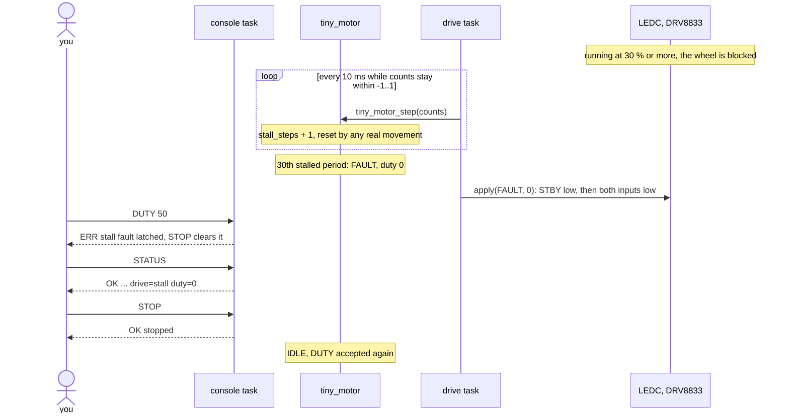

# Wheel node firmware

The firmware for one ESP32-C3 wheel node: one motor through a DRV8833, one Hall encoder, and text commands over the USB port. Build and flash: `docs/dev-setup.md`. Hardware-free logic lives in `components/` (`components/README.md`); this directory holds the code that touches pins, interrupts and FreeRTOS.

| File | What it does |
|---|---|
| `main/main.c` | `app_main`: starts the modules below, the 1 Hz LED blink, and a placeholder 100 Hz telemetry sampler |
| `main/pins.h` | every GPIO the firmware uses, and nowhere else |
| `main/console.c` | the serial commands (`HELP`, `STATUS`, `ENC`, `DUTY`, `STOP`, …), one `OK`/`ERR` reply per line |
| `main/telemetry.c` | `T,` lines on the USB port through a queue, so a slow port never blocks the sampler |
| `main/encoder.c` | encoder pins and interrupt handler; decoding in `tiny_qdec` |
| `main/drive.c` | motor PWM, driver pins and the 100 Hz drive loop; run logic in `tiny_motor` |

## Motor drive

Two parts: `tiny_motor` (component) decides, `drive.c` (here) acts. Two tasks share the motor state: the console task changes it on `DUTY` and `STOP`, and the drive task advances it every 10 ms. They only meet inside the `s_lock` critical section in `drive.c`. Only the drive task writes the driver pins.

### States

| State | Driver | Pins |
|---|---|---|
| `IDLE` | asleep (STBY low) | both inputs low: coast |
| `RUN` | awake (STBY high) | slow-decay PWM from `tiny_motor_pins()` |
| `FAULT` | asleep (STBY low) | both inputs low: coast; latched until `STOP` (or a reset) |

### Boot

### A `DUTY` run

### `STOP`

### Stall trip

