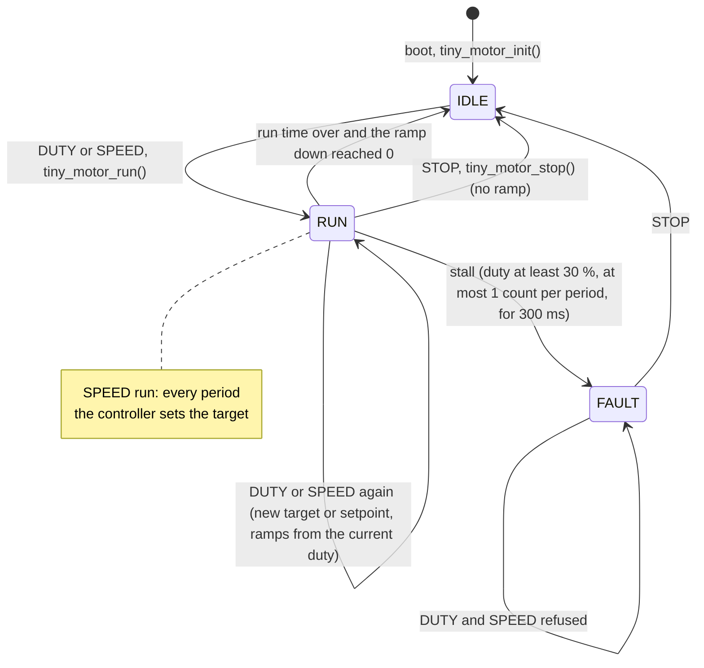
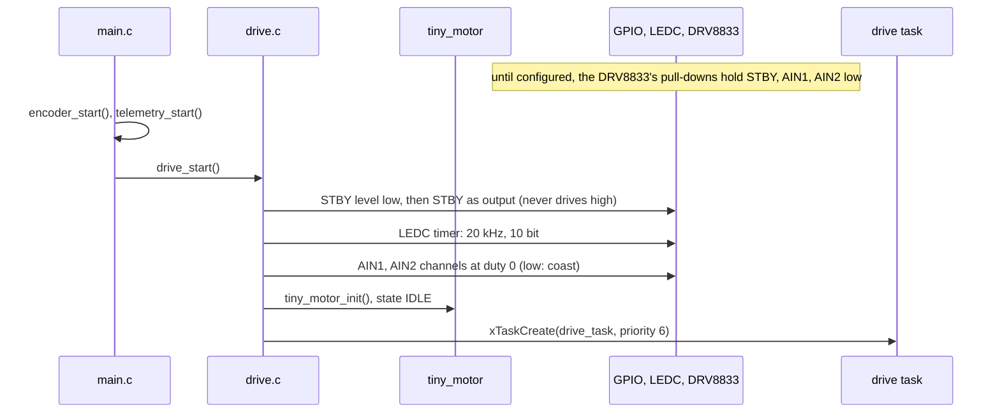
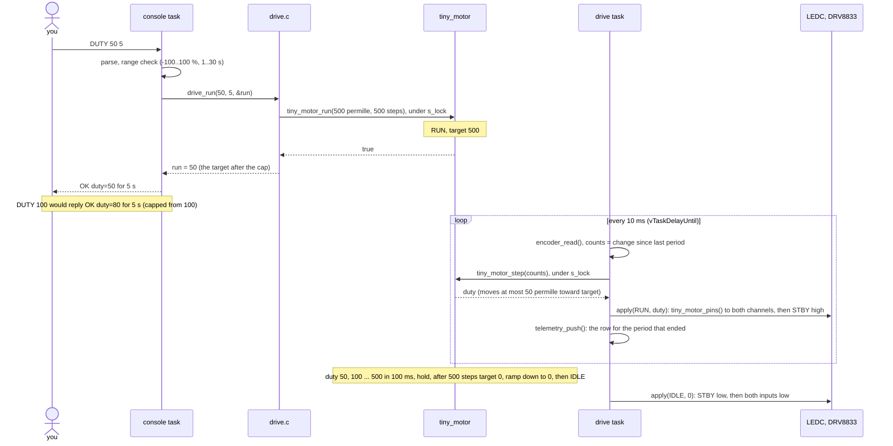
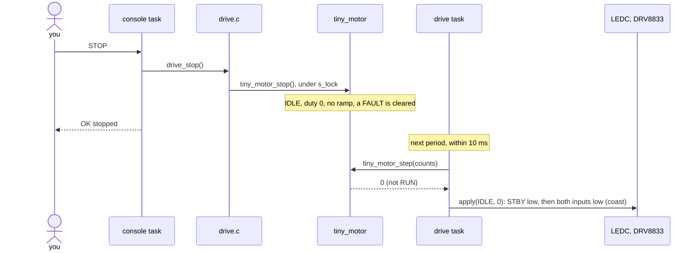
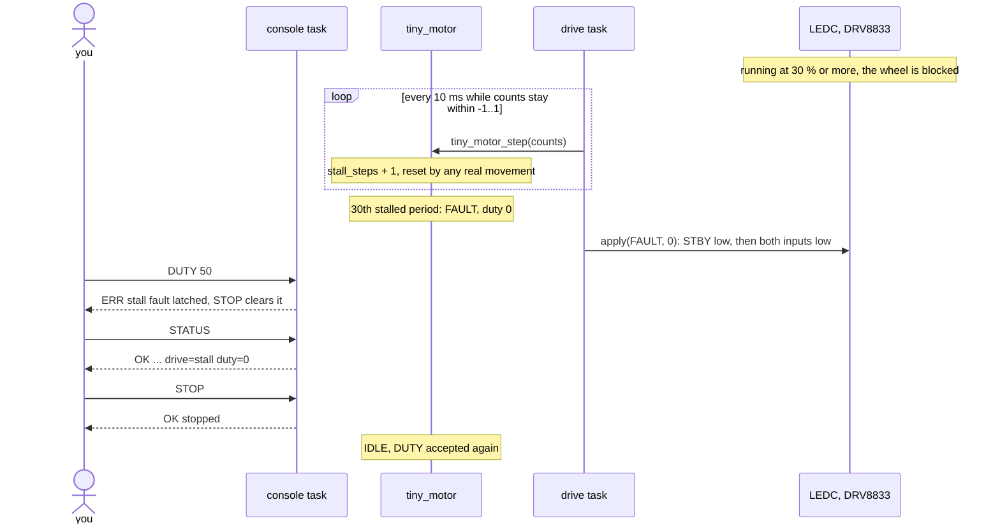
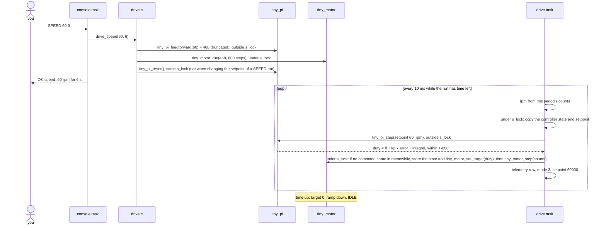

# Wheel node firmware

The firmware for one ESP32-C3 wheel node: one motor through a DRV8833, one Hall encoder, and text commands over the USB port. Build and flash: `docs/dev-setup.md`. Hardware-free logic lives in `components/` (`components/README.md`); this directory holds the code that touches pins, interrupts and FreeRTOS.

| File | What it does |
|---|---|
| `main/main.c` | `app_main`: starts the modules below and the 1 Hz LED blink |
| `main/pins.h` | every GPIO the firmware uses, and nowhere else |
| `main/console.c` | the serial commands (`HELP`, `STATUS`, `ENC`, `DUTY`, `SPEED`, `SET`, `GAINS`, `STOP`, `DECAY`, `PROBE`), one `OK`/`ERR` reply per line; how to use them, with real examples: `COMMANDS.md` |
| `main/telemetry.c` | `T,` lines on the USB port through a queue, so a slow port never blocks the drive task |
| `main/encoder.c` | encoder pins and interrupt handler; decoding in `tiny_qdec`. It feeds B as the decoder's first channel, so positive duty counts up (item E; logs from before have the opposite sign) |
| `main/drive.c` | motor PWM, driver pins and the 100 Hz drive loop, which also runs the speed controller and sends the telemetry rows; run logic in `tiny_motor`, speed in `tiny_speed`, controller in `tiny_pi` |

## Telemetry

`TELEM ON` streams one CSV row per 10 ms control period, sent by the drive task. Each row describes the period that just ended, so its counts and the duty that produced them are on the same line. `tools/plot_run.py` records and plots them.

```
T,t_ms,mode,setpoint_milli,duty_permille,counts,rpm_milli
T,10827744,3,60000,470,44,61111
```

| Column | Meaning |
|---|---|
| `t_ms` | time at the end of the period, ms since boot |
| `mode` | 0 idle, 1 `DUTY` run, 2 stall fault, 3 `SPEED` run (also during its ramp down) |
| `setpoint_milli` | the `SPEED` setpoint, rpm × 1000, while the controller is active; 0 otherwise, including the ramp down at the end of a `SPEED` run |
| `duty_permille` | signed duty output during the period, ‰ (+1000 full forward) |
| `counts` | encoder counts during the period, signed |
| `rpm_milli` | wheel speed from those counts, rpm × 1000 (`tiny_speed`, 4320 counts per turn) |

One count per period is 1.389 rpm, so `rpm_milli` moves in steps of about 1389 and flickers at low speed. Values are scaled integers, so the node never formats floats.

`ENC ZERO` while telemetry is on makes the position jump, so the next row shows one large false `counts` and `rpm_milli` (minus the position before the reset); the rows after it are normal again.

## Motor drive

Two parts: `tiny_motor` (component) decides, `drive.c` (here) acts. Two tasks share the motor state: the console task changes it on `DUTY`, `SPEED`, `SET` and `STOP`, and the drive task advances it every 10 ms. They only meet inside the `s_lock` critical section in `drive.c`. Only the drive task writes the driver pins.

`s_lock` masks interrupts, the encoder's too, so an encoder edge that arrives inside it waits until the lock is released; if a second edge comes first, the decoder sees a jump of two steps and counts it as `invalid`. So only short integer work happens under the lock, and the controller's float math (software float: the C3 has no FPU) runs on copies outside it. Measured 2026-11-02 with the CPU cycle counter, longest locked section per run: 50 µs with the controller inside it, 8.8 µs after moving it out (`SPEED 100`), against encoder edges as close as 14.4 µs apart at full speed (D.4.4). `invalid` stayed 0 in all those runs.

### States



| State | Driver | Pins |
|---|---|---|
| `IDLE` | asleep (STBY low) | both inputs low: coast |
| `RUN` | awake (STBY high) | PWM from `tiny_motor_pins()` in the decay mode set by `DECAY` (slow at boot) |
| `FAULT` | asleep (STBY low) | both inputs low: coast; latched until `STOP` (or a reset) |

### Boot



### A `DUTY` run



### `STOP`



### Stall trip



### Speed control (`SPEED`)

A `SPEED` run is a `tiny_motor` run whose target duty the speed controller (`tiny_pi`) sets every period, so the cap, the slew limit, the stall trip and the run timer all still apply exactly as for `DUTY`. Each period, in `drive_task`:

1. the speed of the period that just ended is computed from the encoder counts (`tiny_speed`);
2. if a `SPEED` run is going and its time isn't up, `tiny_pi_step()` turns the setpoint and that speed into a duty, and `tiny_motor_set_target()` makes it the run's target without restarting the timer;
3. `tiny_motor_step()` moves the output towards the target as usual.

Once the time is up the controller stops and `tiny_motor` ramps down to 0 as after `DUTY`, so the controller never fights the ramp. A `DUTY` or `STOP`, a stall or the end of the run ends the speed run.



The controller (`components/tiny_pi`, all in permille duty and wheel rpm):

| Part | Value at boot | Why |
|---|---|---|
| feedforward | 7.3 ‰ per rpm × (\|setpoint\| + 4.2 rpm), signed | the measured D.4 line, 1.37 rpm per % with the wheel starting at about 4.2 rpm less; gives about the right duty at once, so the other two only correct the rest |
| `kp` | 6 ‰ per rpm of error | reacts to the error now |
| `ki` | 20 ‰ per rpm of error per second | removes a steady error (a load); stored already multiplied by `ki`, so changing `ki` mid-run doesn't make the duty jump |
| anti-windup | integral limited to ±800 and frozen while the output is past ±800 in the direction the error pushes | after a blocked wheel is released it doesn't race off |

`kp` and `ki` come from a simulation of the D.4 line with a 60 ms time constant (`test/host/test_tiny_pi.c` uses the same model). `SET` changes `kp`, `ki` and `ff` live; `GAINS` shows them. They aren't saved.

Bench check (2026-11-01, 7.4 V, wheel free, boot gains, logs `logs/20261101-2145*-e-*.csv`):

| Check | Result |
|---|---|
| sign: `ENC ZERO`, `DUTY 20 2`, `ENC` | `pos=3320`, positive as intended |
| `SPEED 60 6` and `SPEED -60 6` | 90 % of the setpoint after 120 ms, peak 65 / −64 rpm, then 59.9 to 60.6 rpm in 100 ms averages; supply 53 mA |
| step: `SPEED 30 6`, then `SPEED 80 3` after 3 s | 90 % after 90 ms, peak 81.9, settled at 80.2 |
| a finger lightly on the wheel for 5 s at 60 rpm | dipped to about 53, back to 60 while still loaded, at about +130 ‰ duty; 66 rpm for about a second after release |
| the wheel gripped at 60 rpm | the duty rose to the 800 ‰ cap, the stall trip fired 300 ms after the wheel stopped |

A load heavier than the cap can make up (a firm grip that still lets the wheel turn) leaves the duty at 800 ‰ until the run's time is up; only a full stop trips the stall check.

`SPEED 0` is an ordinary setpoint, not "off". From standstill it starts a run with target 0 at duty 0, which `tiny_motor` ends at once. During a run the controller stays on with its integral, so it brakes with reverse duty: the P term alone is kp × −rpm. Once the wheel stands, the error is 0 and the integral stays wherever braking left it. That leftover duty is applied until the run's time is up, because `tiny_motor` ends a run early only when target and duty are both exactly 0. Bench, 2026-11-03 (`logs/20261103-150247-speed0.csv`):

- 60 rpm to 0 in about 120 ms, at most −128 ‰;
- then 43 counts (1 % of a turn) backwards;
- then held at −57 ‰, below the duty that starts the wheel, for the remaining 5 s.

Host test: `test_setpoint_zero_brakes_to_rest`.

### Decay mode

What the motor does in the off part of each 50 µs PWM period. `DECAY SLOW|FAST` picks it; it is refused while a run is going, so the mapping never changes mid-run, and `STATUS` shows it.

| Mode | Forward pins | Off part | Effect |
|---|---|---|---|
| slow (default) | IN1 high, IN2 PWM (low = drive) | both high: the driver shorts the motor | the current fades slowly and brakes a little; speed follows duty almost linearly |
| fast | IN1 PWM (high = drive), IN2 low | both low: coast | the current returns to the supply through the driver's diodes; much weaker at the same duty. Bench motor, swept down while turning (D.4.5): 93 / 62 / 33 / 9 rpm at 80 / 70 / 60 / 50 %, stops below ≈ 45 %; from standstill it doesn't start even at 50 %. Slow decay at the same steps: 106 / 93 / 79 / 65 rpm, linear down to 2.3 rpm at 5 % |

## Interrupt probe

`PROBE ON` makes GPIO1 an output that is high while `encoder_isr` runs; `PROBE OFF` (the default) leaves it undriven. With the logic analyzer on A, B and GPIO1:

- the width of each probe pulse is the handler's own run time;
- the gap from an A or B edge to the probe's rising edge is the interrupt entry: the CPU saving the task and ESP-IDF's GPIO dispatcher finding the pin;
- the return after the probe falls (dispatcher exit, task restore) isn't visible, so the measured total is a lower bound.

The interrupt load at a given speed is about edges per second × time per interrupt. GPIO1 is reserved for the corner LED in Phase 4; the probe moves or goes away then.
