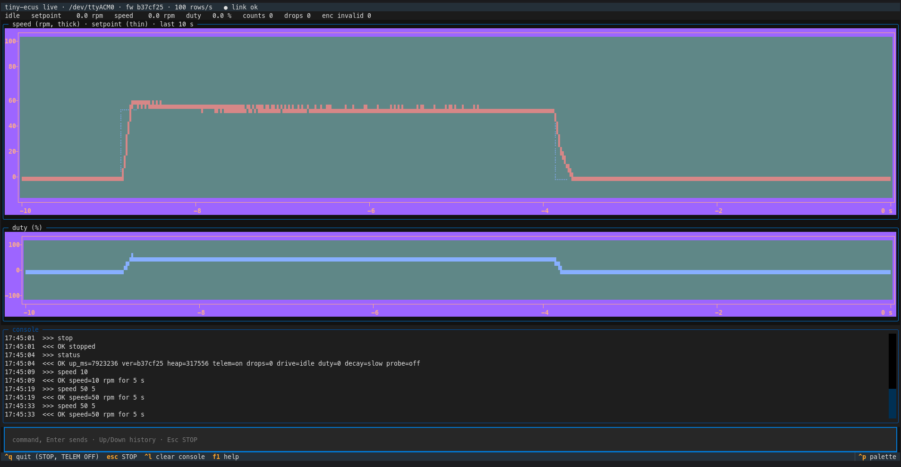

# Bench tools

Python programs that talk to a node's console over USB: the wheel node's, and with `send_cmd.py --board cam` the gateway's. Only one program can hold the port at a time.

| Tool | What it is for |
|---|---|
| `live.py` | at the bench: live plot and status, and a command line; runs until you quit it |
| `send_cmd.py` | scripted: send commands, print each reply, exit |
| `plot_run.py` | scripted: record telemetry for a fixed time, save a CSV and a PNG under `logs/` |
| `nodelink.py` | shared by the three: opening the port, sending, splitting the input into lines, telemetry rows and the gateway's `CANMON` frames |
| `pi_figure.py` | no port: redraws the README's PI figure (`docs/images/pi-speed-control.png`) from the two runs kept in `docs/data/` |

`send_cmd.py` and `plot_run.py` always end by themselves, so scripts (and Claude) use them. `live.py` is interactive and never ends by itself.

## Setup

Once, about 450 MB, most of it PyQt6, which `plot_run.py` needs to open a plot window:

```sh
python3 -m venv tools/.venv
tools/.venv/bin/pip install -r tools/requirements.txt
```

## live.py

```sh
tools/.venv/bin/python tools/live.py              # --port /dev/ttyACM1 for another port
```



*A `SPEED 50 5` run on the bench node (2026-11-03): the step up, the hold, and the coast-down after the run's time ran out. The thin setpoint line shows where the speed differs from it, at the step and at the end.*

On start it sends `TELEM ON`. The screen, from the top:

- **Top bar:** port, firmware version, telemetry rate (100 rows/s while it streams), link state.
- **Status line:** the newest telemetry row with units: mode (`idle`, `DUTY run`, `SPEED run`), setpoint, speed, duty, counts. Then `drops` and the encoder's `invalid` count, read from `STATUS` and `ENC`, which the tool sends every 2 s without showing their replies. A stall turns the line red until it is cleared.
- **Speed plot:** the last 10 s; speed as the thick line, the setpoint as the thin one. The setpoint shows wherever the speed differs from it.
- **Duty plot:** the same 10 s, in %.
- **Console:** every command sent and every line that isn't telemetry (replies, ESP-IDF log lines), with the PC's time.
- **Input line:** any node command; Enter sends it. `HELP` lists the commands.

| Key | Does |
|---|---|
| Esc | sends `STOP`, whatever is typed in the input line |
| Ctrl+Q (or Ctrl+C) | sends `STOP` and `TELEM OFF`, then quits and releases the port |
| Up / Down | command history |
| Ctrl+L | clears the console |
| F1 | key help in the console |

If the port goes away (cable pulled, board reset), the top bar shows "link lost" and the tool reopens the port by itself when it's back. After a reconnect it sends only the hidden `STATUS`/`ENC` polls, nothing that changes the node. A node that was reset has telemetry off, so send `TELEM ON`. Unlike the scripts, the tool doesn't send `STOP` on a stall: the driver is already off and latched, and you clear it yourself with Esc.

Columns the tool doesn't know (from newer firmware) appear in the status line as `name=value`.

## send_cmd.py

```sh
tools/.venv/bin/python tools/send_cmd.py STATUS "HELP TELEM"
```

Sends each command and prints its one-line reply (`OK ...` or `ERR ...`). Exits non-zero if any reply was `ERR` or missing. For the gateway add `--board cam` (port `/dev/ttyUSB0`):

```sh
tools/.venv/bin/python tools/send_cmd.py --board cam STATUS CAN
```

## plot_run.py

```sh
tools/.venv/bin/python tools/plot_run.py --seconds 5 --label test --cmd "SPEED 60 3"
```

Switches telemetry on, records it for a fixed time, then saves a CSV and a PNG under `logs/` and opens a plot window. `--cmd "..."` sends extra commands at the start; `--no-show` skips the window.

## The port

All three open the port in a way that doesn't reset the C3: DTR high, RTS low (see `open_port()` in `nodelink.py`). `idf.py monitor` does reset it, which is useful to see the boot log, but it never ends by itself.

The gateway's ESP32-CAM-MB resets the ESP32 whenever RTS is on, and Linux turns RTS and DTR on at every open, except when the port's speed setting is B0. So `open_port(port, "cam")` leaves the port at B0 (the CH340 keeps sending at 115200). The first open after a flash or after plugging the board in sets this up, which resets the gateway once; later opens don't.

## Tests

```sh
tools/.venv/bin/pip install -r tools/requirements-test.txt
tools/.venv/bin/python -m pytest tools/tests
```

They run without a board. `tests/conftest.py` has a fake port that the tests push node output into and read the tool's commands from; `live.py` runs headless (Textual's test mode). CI runs them in the `tools-tests` job, installing only `requirements-test.txt`.
